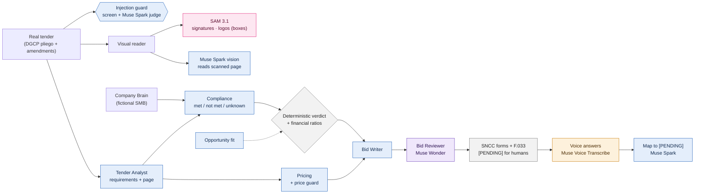

# Postor AI Bid Team

A multi-agent AI system that takes a small business from a public procurement
opportunity to an honest, evidence-backed answer: **bid here, bid with
conditions, don't bid, or let a human decide** — plus a first draft of the
technical proposal when bidding makes sense.

Built for the Meta AI Developer Hackathon (Startup track, _Build for Your
World_) with **five Meta models**, each with one job: **Muse Spark** reads,
judges and drafts, **Muse Wonder** audits the draft, **SAM 3.1** localizes
official marks on scanned pages, **Muse Voice Transcribe** lets the bid manager
answer open `[PENDING]` items by voice, and **Llama Prompt Guard 2 (86M)** —
Meta's open-weights prompt-injection classifier, self-hosted on **Modal** and
called by URL — screens every tender page before the agents read it, with Muse
Spark confirming what it flags.

### What Postor does

1. **Finds and reads the tender** — real Dominican public tenders (DGCP
   portal): pliego, amendments and official forms, never modified.
2. **Checks it against the company** — every requirement against the
   company's private _Company Brain_ (certifications with expiry dates,
   projects, finances, team), citing document + page.
3. **Decides honestly** — _GO / GO WITH CONDITIONS / NO GO / NEEDS REVIEW_,
   with financial ratios, revenue concentration and conditions with owner and
   deadline.
4. **Prepares the bid** — a technical proposal draft audited by a second
   model, the SNCC forms and the tender's own **F.033 economic offer with
   prices** (store and rate-card costs, ITBIS, total in words).
5. **Leaves the human in charge** — anything unproven stays `[PENDING]`; the
   bid manager can answer by voice. Postor never submits, signs or sends.

### Postor is a live product — Meta completes the flow

Postor is not a hackathon concept: it is a live, paid SaaS for Dominican
public procurement at **[postor.do](https://postor.do)**, already used by a
small number of paying customers (7-day trial, then US$49.99/month or
US$479.90/year, up to 5 users per company).

|                     | Postor before the hackathon ([postor.do](https://postor.do))                                  | Postor with Meta AI (this repository)                                                                                                                |
| ------------------- | --------------------------------------------------------------------------------------------- | ---------------------------------------------------------------------------------------------------------------------------------------------------- |
| **Find**            | Tenders from DGCP open data, filtered by the company's categories, institution and modality   | Same, plus the tender's own pliego, amendments and official forms read end to end                                                                    |
| **Understand**      | Pliego analysis: an overview of what the tender requires, with citations to document and page | Every requirement checked against the company's own evidence (certifications with expiry dates, projects, finances, team), citing both sides         |
| **Decide**          | Left to the customer                                                                          | An honest verdict — _GO / GO WITH CONDITIONS / NO GO / NEEDS REVIEW_ — with financial ratios, revenue concentration and conditions with owner + date |
| **Prepare the bid** | Checklist of documents and dates to organize                                                  | A technical proposal draft audited by a second model, the SNCC forms and a priced F.033 economic offer; unknowns stay `[PENDING]`                    |
| **Trust**           | Citations to the source                                                                       | Every model call traced (prompt, response, tokens, cost estimate), scanned seals localized by SAM 3.1, every page screened for prompt injection      |

In short: the live product helps a company **find** a tender and **see what
it asks for**; with Muse Spark, Muse Wonder, SAM 3.1, Muse Voice Transcribe
and Llama Prompt Guard 2, Postor covers the **whole path from tender to
bid-ready draft**. This repository is the hackathon build of that new flow
(written during the event, see [Disclosures](#disclosures)); it is what we
will bring into the production product. In both, the company keeps the
decision and submits on the official SECP portal itself.

**Contents:** [For judges](#for-judges--start-here) ·
[Meta models](#meta-models-we-use--and-where-they-run) ·
[The demo](#the-demo) · [Why this matters](#why-this-matters-dominican-republic) ·
[Run it](#run-it) · [Deploy (Dokploy)](#deploy-on-dokploy) ·
[Disclosures](#disclosures)

## For judges — start here

1. **Try it live:** **https://demo.postor.do** (access token in our
   submission; deployed from this repo with [`compose.dokploy.yml`](compose.dokploy.yml)). The four tenders already show real recorded runs; to run a new
   analysis, paste your own Meta API key in the ficha (it is used for that run
   only, never stored).
2. **Follow the 3-minute walkthrough** below.
3. **See how each Meta model is used** in the map and table below (also in the
   app: **How it works**).
4. **Run it yourself** (optional): see [Run it](#run-it) — Node, or one
   `docker compose` command.

### 3-minute walkthrough

| #   | Where                                                     | What to look at                                                                                                                                                             |
| --- | --------------------------------------------------------- | --------------------------------------------------------------------------------------------------------------------------------------------------------------------------- |
| 1   | **Opportunities**                                         | 4 real DGCP tenders with verdict, match level, amount and close date.                                                                                                       |
| 2   | **Company Brain**                                         | The fictional bidder: certifications with expiry dates, projects, finances, known gaps.                                                                                     |
| 3   | Case A → **Open** → _Fast_ mode → **▶ Run live analysis** | Live progress per step and a clock (≈1.5–2.5 min).                                                                                                                          |
| 4   | **Analysis**                                              | Verdict, conditions with owner + deadline, financial ratios, document safety (injection guard).                                                                             |
| 5   | **Requirements** → click any `pliego pN`                  | The cited page of the ORIGINAL PDF, rendered, with the requirement text.                                                                                                    |
| 6   | **Products** → open a scanned page                        | SAM 3.1 boxes over the original page + Muse Spark's reading.                                                                                                                |
| 7   | **Trace**                                                 | Every model call: model, prompt sent, response, tokens, duration, estimated cost.                                                                                           |
| 8   | **Forms** → F.033 · **Stores (DEMO)**                     | The economic offer: cost from fictional stores or NovaTech's hourly rates, one markup to ~97% of the budget, ITBIS, total and amount in words. Signature stays `[PENDING]`. |
| 9   | **Documents** → 🎙 Record answer                           | Answer a `[PENDING]` by voice: Muse Voice Transcribe + Muse Spark map it, shown as "declared", never as proof.                                                              |
| 10  | Cases C and D → **Analysis**                              | Same system, different verdicts: NO GO (manufacturer authorization) and NEEDS REVIEW (contract ≈ 86% of revenue).                                                           |

### Meta models we use — and where they run

Four models are called on the **Meta Model API**
(`https://api.meta.ai/v1`) with one key (`META_API_KEY`, see
[`.env.example`](.env.example)). The fifth, **Llama Prompt Guard 2 (86M)**,
Meta's open-weights injection classifier, runs self-hosted on Modal ([`deploy/modal/prompt_guard.py`](deploy/modal/prompt_guard.py)),
screens every tender segment when `POSTOR_GUARD_URL` is set, and Muse Spark
confirms what it flags (live: the DEMO trap is caught, the one false positive
on the real tenders is cleared).



Blue = Muse Spark · purple = Muse Wonder · pink = SAM 3.1 · amber = Muse Voice
Transcribe · grey = deterministic code (no model).

| Meta model                  | Hosted                                                                          | Used by                                                                                                 | How                                                                                                                                                                                                                                                                            | Code                                                                            |
| --------------------------- | ------------------------------------------------------------------------------- | ------------------------------------------------------------------------------------------------------- | ------------------------------------------------------------------------------------------------------------------------------------------------------------------------------------------------------------------------------------------------------------------------------ | ------------------------------------------------------------------------------- |
| `muse-spark-1.3`            | Meta Model API                                                                  | Opportunity, Tender Analyst (full mode), Compliance, Pricing, Bid Writer, vision reads of scanned pages | JSON-only prompts validated with Zod (one schema retry); 12-page windows and requirement batches run 4 in parallel                                                                                                                                                             | `apps/api/src/agents/*`, `apps/api/src/models/meta-model.service.ts`            |
| `muse-wonder-1.0`           | Meta Model API                                                                  | Bid Reviewer                                                                                            | A different model audits the draft Muse Spark wrote: omissions, unsupported claims, contradictions (live: ~16 s)                                                                                                                                                               | `apps/api/src/agents/reviewer/reviewer.agent.ts`                                |
| `sam-3.1`                   | Meta Model API (`/responses`)                                                   | Visual reader                                                                                           | One concept per call ("handwritten signature", "logo") on the rendered page; returns pixel boxes drawn over the original in the UI                                                                                                                                             | `apps/api/src/agents/visual/visual-evidence.service.ts`                         |
| `muse-spark-1.3` (guard)    | Meta Model API                                                                  | Document guard                                                                                          | A deterministic screen finds AI-directed language in every pliego chunk; Muse Spark (`document-guard-v1`) judges only those. Flagged text is shown, never obeyed. Live: the DEMO trap → 99%; 1 of 566 real chunks escalated and cleared                                        | `apps/api/src/models/document-guard.service.ts`                                 |
| `Llama-Prompt-Guard-2-86M`  | Meta open weights, self-hosted on **Modal** (`POSTOR_GUARD_URL` + bearer token) | Document guard                                                                                          | Scores every pliego/amendment segment (≤400 chars, 4 batches in parallel) for injection; flags go to Muse Spark for confirmation. Live: DEMO trap 82% → confirmed; one real false positive (0.99, case D) cleared by Spark. Without the URL the guard runs on Muse Spark alone | `apps/api/src/models/document-guard.service.ts`, `deploy/modal/prompt_guard.py` |
| `muse-voice-transcribe-1.0` | Meta Model API (`/asr/transcribe`)                                              | Voice answers                                                                                           | The bid manager dictates answers to `[PENDING]` items; the WAV is transcribed (Spanish bias, acronyms as keywords) and Muse Spark (`voice-note-v1`) maps each statement to its item as a user declaration                                                                      | `apps/api/src/workflow/voice-note.service.ts`, `apps/web/src/voice.ts`          |

**Deep dive:** [`META-MODELS.md`](META-MODELS.md) explains how each model is
called, validated, guarded, traced and what happens when it fails.

What is deliberately **not** a model: the Go/No-Go verdict, financial ratios
and revenue concentration, price validation, the offer price (markup, ITBIS,
totals, amount in words), mandatory-requirement coverage, and form filling
are deterministic code, so the model can never invent a price or flip a
verdict on its own.

**The economic offer (SNCC.F.033).** Each tender's items are transcribed
from the pliego with their page (`data/tenders/*/items.json`). The pricing
agent (Muse Spark, `pricing-v2`) picks the cheapest valid product for each
good from five fictional stores (`data/suppliers/tiendas-DEMO.json`, also
shown in the app under **Stores (DEMO)**) and, for services, only estimates
hours per role. Code then checks every cost literally against the catalog,
computes services as hours × NovaTech's rate card, and applies the company's
pricing policy (`data/company-brain/pricing-policy.json`): total with ITBIS at
97% of the reference budget (band 95–99%), never under a 10% margin, with
incomplete, over-budget or unusually high-margin offers flagged. Live: case D
→ RD$ 8,481,486.60 (97%, 21% margin, every line under the entity's own
estimate); case A → RD$ 1,940,000.00.

## The demo

One fictional IT company (**NovaTech Solutions SRL** — every company record is
invented and DEMO-marked, never a real bidder) is evaluated against 4 real,
open Dominican public tenders (DGCP portal, unmodified originals):

| Case                           | Design intent      | Live verdict     | Why (cited by the system)                                                       |
| ------------------------------ | ------------------ | ---------------- | ------------------------------------------------------------------------------- |
| A · CNE software on Azure      | GO                 | **GO**           | experience, 2 reference letters, Azure CV + certification, RPE/TSS/DGII current |
| B · INDOTEL Wi-Fi deployment   | GO_WITH_CONDITIONS | **NO_GO**        | the real pliego (p25) requires 2+ similar Wi-Fi projects; the company has 1     |
| C · UAF Microsoft 365 renewal  | NO_GO              | **NO_GO**        | Microsoft partner/CSP authorization required; a distributor quote is not one    |
| D · ISFODOSU network equipment | NEEDS_REVIEW       | **NEEDS_REVIEW** | ratios pass (2.68 / 1.8 / 0.60) but the contract ≈ 86% of annual revenue        |

The point: the same pipeline says _go_ and _don't go_ **for the right reasons**,
with every claim traced to a tender clause and a company document. Where the
real pliego is stricter than the dataset's design (case B), the system follows
the document: the design counted PROJECT-005 as a second Wi-Fi project, but its
record is general IT support (GLPI, AnyDesk, Zabbix) with no Wi-Fi scope, so
only PROJECT-004 (14 Wi-Fi 6 APs) qualifies — see
[`EXECUTION-SUMMARY.md`](EXECUTION-SUMMARY.md).

## Why this matters (Dominican Republic)

Figures from Postor's market research (Oct 2026), built on DGCP official
data; each is labeled with its origin.

- **The market:** the public procurement system (SECP) transacted
  **RD$262,654 M in 2024** (≈ US$4.3 B, own calculation) across **64,851
  processes** and **173,004 offers** — _official, DGCP 2024 bulletin_.
- **The funnel is the problem:** **129,813** companies are registered as state
  suppliers, but only **38,943** participate actively (_press, 2025_); **14,536**
  bid in 2024 and **11,672** won at least once (_official_). Most registered
  businesses never turn registration into a bid.
- **SMBs are the policy target:** MIPYMES won **34.42%** of the 2024 amount
  (RD$90,419 M, _official_). Law 47-25 (in force Jan 2026) raises the MIPYME
  reserve to **30%** and removes the bid-security guarantee for them — more
  small businesses will be invited to compete.
- **Bids are lost on paperwork:** DGCP returns ~**1 in 5** supplier
  registrations and ~**1 in 3** updates for documentation problems, and its
  monitoring flags expired legal documents and suppliers bidding outside their
  registered activity as recurring errors (_official, DGCP 2025 report_).
- **No tooling for the bidder:** existing tools are official discovery apps;
  the research found no documented Dominican product that analyzes a pliego
  against a company's own evidence.

**Postor's answer:** read the real tender, check it against the company's own
documents (validity dates included), say _go / go with conditions / no go /
needs review_ with page-level evidence, and prepare the official forms and a
priced F.033 — leaving the final decision, signatures and anything unproven to
a human.

## How it works

A Bid Orchestrator coordinates six specialized agents — Opportunity, Tender
Analyst, Compliance, Research & Pricing, Bid Writer, Bid Reviewer — over a
private Company Brain (structured profile as source of truth, documents as
evidence, hybrid retrieval). Agents exchange Zod-validated objects, never free
text, and nothing invented ever becomes a fact: unknowns are `[PENDING: ...]`.

Every AI call is logged and inspectable in the **Trace** view: prompt sent,
response received, tokens, duration, and cost estimate. No black boxes.

## Run it

You need a Meta Model API key for live analyses (`META_API_KEY`). Without
one, everything except **▶ Run live analysis** still works on the four
recorded runs.

### Option A — Node (development)

Requirements: Node 22+ (`.nvmrc`), npm. Docker is optional (Postgres); without
it everything runs on a disposable local SQLite database.

```bash
npm install
cp .env.example .env            # paste your META_API_KEY
npm run init -- --db=sqlite     # builds, loads data + Company Brain, live smoke test, readiness report
npm run dev                     # API on :3000 + web on http://localhost:5173
```

**No API key?** Run `npm run init -- --db=sqlite --offline` instead: it skips
the key check and loads real recorded runs of all four tenders
(`data/demo-runs/snapshot.json`), so the feed, verdicts, evidence, SAM regions,
the priced F.033 and the full Trace are explorable.

`npm run seed` validates the dataset offline (no key, no model calls);
`npm run doctor` diagnoses the environment. Tests: `npm test`.

### Option B — Docker Compose (same as production)

```bash
cp .env.example .env            # optional: META_API_KEY, DEMO_ACCESS_TOKEN
docker compose -f compose.dokploy.yml up --build -d
docker compose -f compose.dokploy.yml exec app \
  node -e "fetch('http://127.0.0.1:3000/api/health').then(r=>r.text()).then(console.log)"
```

One container serves the API and the web app on port 3000; SQLite and the
generated files live on the `postor-storage` volume. The first boot (~1 min)
creates the database, loads the fictional Company Brain and imports the four
recorded runs. To open it in a browser, publish the port with an override,
e.g. `docker run --rm -p 3000:3000 --env-file .env -v postor-storage:/app/storage postor-demo:latest`.

### Using it

**Opportunities** → pick a case → **Open** → **▶ Run live analysis** (mode **Fast**: the key-requirements dossier, ~1.5–2.5 min;
**Full**: the whole pliego, 10–20 min) and watch each agent step complete
(real 2 s polling, no fake animations). Then walk the tabs: Analysis (verdict,
conditions with owner + deadline, document safety), Requirements (click any
`pliego pN` to open the cited page of the original PDF), Products/Costs,
**Trace** (every model call: prompt sent, response, tokens, duration,
estimated cost), **Forms** (the priced F.033 and the SNCC forms) and
Documents (editable files after human validation; answer `[PENDING]` items by
voice).

## Deploy on Dokploy

1. **Create → Compose** service from this GitHub repo, branch `main`,
   compose path **`./compose.dokploy.yml`**.
2. **Environment:** `DEMO_ACCESS_TOKEN` (long random string, handed to judges),
   `POSTOR_REQUIRE_USER_KEY=true` (visitors paste their own Meta key, used for
   that run only), optionally `META_API_KEY`. Full table in [`DEPLOY.md`](DEPLOY.md).
3. **Domains:** `demo.postor.do` → service `app`, port `3000`, HTTPS on.
4. **Deploy.** The healthcheck (`/api/health`) turns green after the first
   boot; open the domain, enter the access token and browse the recorded runs.

The `postor-storage` volume keeps the database between deploys; every boot is
idempotent.

## Repository layout

```text
apps/api/            # NestJS: orchestrator, agents, documents, brain, observability
apps/web/            # React + Vite: opportunities, live analysis, results, trace
packages/contracts/  # Shared Zod-validated agent contracts
data/                # Fixtures: company-brain/ tenders/ suppliers/ templates/ lite/ demo-runs/
deploy/              # Container entrypoint, optional Modal guard
compose.dokploy.yml  # Docker Compose for Dokploy / any Docker host
storage/             # Generated by seed (gitignored)
```

Tenders ship as local fixtures for the demo; in production they arrive through
an external procurement API behind the same `TenderSource` interface.

## Rules the system lives by

- Real tender documents, fictional company — never mixed up, never mislabeled.
- Evidence or it didn't happen: findings cite document + page.
- Missing evidence means `unknown`, not failure (unless the tender makes the
  document a pass/fail admissibility criterion).
- Drafts stay drafts until a human reviews them. Postor never submits or signs.

## Status

Hackathon build (Oct 26 – Nov 4, 2026). See [`EXECUTION-SUMMARY.md`](EXECUTION-SUMMARY.md)
for live results per case, per-agent timings, and what remained out of scope.

## Disclosures

- **Built during the event.** All code in this repository was written between
  Oct 26 and Nov 4, 2026; no pre-existing code was reused. Development used AI
  coding assistance (Claude Code; commits are co-authored accordingly). The
  web UI was rebuilt in TypeScript from a UI mock-up made for this project
  during the event (not included in the repo).
- **Third-party data.** The tender documents under `data/tenders/` are public
  records downloaded from the Dominican DGCP procurement portal, unmodified.
  Market figures in "Why this matters" come from DGCP publications and
  Dominican press, each labeled with its source type.
- **Generated data.** The company (NovaTech Solutions SRL), its documents and
  the lite-mode key-requirement dossiers (`data/lite/`) are fictional and were
  produced for this demo with scripts and AI assistance (Muse); they are
  DEMO-marked and never presented as real.
- **Libraries.** Open-source npm packages (NestJS, React, Vite, Prisma,
  pdf.js, docx tooling, Zod, …) under their own licenses, installed from npm.
  The optional Prompt Guard 2 backend uses Meta's Llama Prompt Guard 2 under
  the Llama 4 Community License.

## License

Code: [MIT](LICENSE). The tender documents under `data/tenders/` are public
records from the Dominican DGCP procurement portal, included unmodified for
traceability; they are not covered by this license. All company data
(NovaTech Solutions SRL) is fictional and DEMO-marked.
